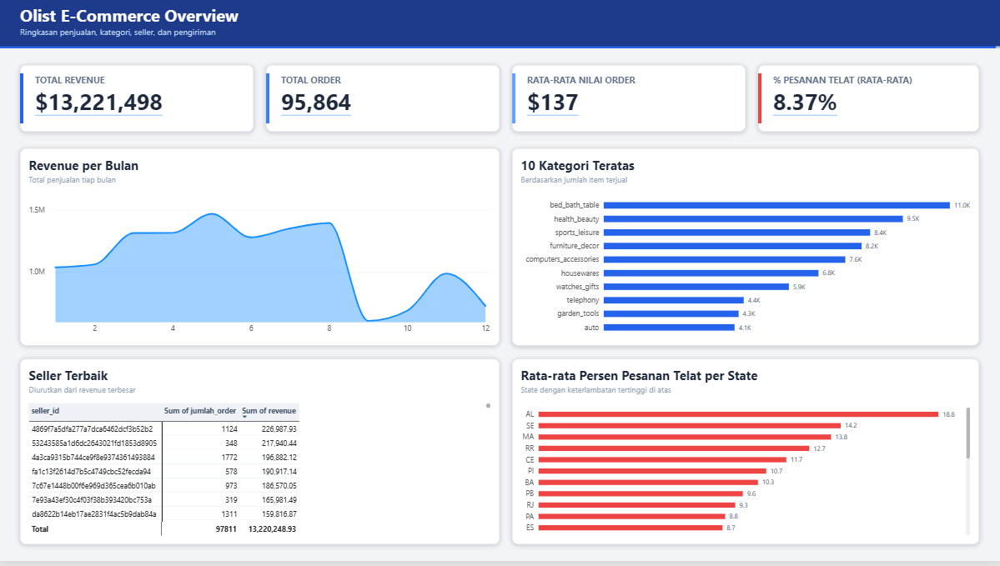
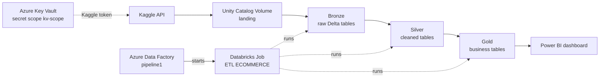
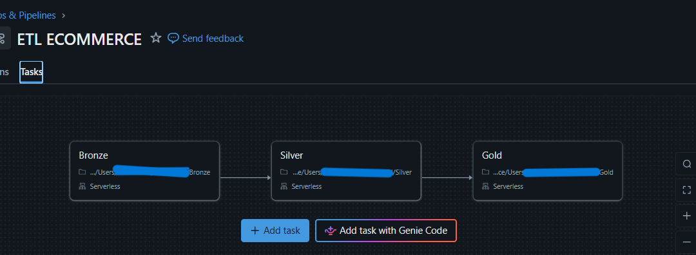
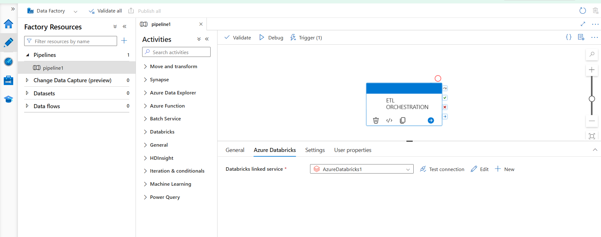
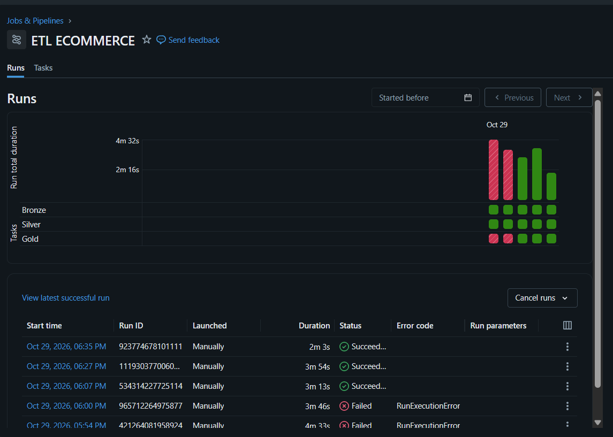

# Olist E-Commerce Data Pipeline

An end-to-end data engineering project on Azure. It downloads the public Olist e-commerce dataset, cleans it in three layers (Bronze, Silver, Gold) on Databricks, orchestrates the run with Azure Data Factory, and serves the Gold tables to a Power BI dashboard.



## Business question

How does an online marketplace perform across time, product categories, sellers and delivery regions? The dashboard answers four things:

- How much revenue and how many orders came in, and what is the average order value?
- How does revenue change month by month?
- Which product categories sell the most?
- Which sellers earn the most, and which states have the highest share of late deliveries?

## Architecture



## Tools

| Area | Tool |
|---|---|
| Cloud | Microsoft Azure |
| Storage | Azure Storage, Azure Data Lake Storage, Unity Catalog Volume |
| Processing | Azure Databricks, PySpark |
| Table format | Delta Lake, Unity Catalog |
| Secrets | Azure Key Vault, Databricks secret scope |
| Orchestration | Databricks Jobs, Azure Data Factory |
| Reporting | Power BI Desktop |
| Source data | Kaggle API |

## Data layers

| Layer | Notebook | What it does |
|---|---|---|
| Bronze | [`01_bronze.ipynb`](notebooks/01_bronze.ipynb) | Downloads the Kaggle dataset into a dated landing folder and writes each CSV as a Delta table, unchanged |
| Silver | [`02_silver.ipynb`](notebooks/02_silver.ipynb) | Removes duplicates, converts date columns to timestamps, casts prices to numbers, drops negative prices, fixes column typos, and runs data quality checks |
| Gold | [`03_gold.ipynb`](notebooks/03_gold.ipynb) | Builds four business tables from delivered orders |

Silver data quality checks:

- `assert` that `orders.order_id` has no nulls and `order_items.price` has no negative values
- A null report across every Silver table (null count and percent per column)
- `assert` that key columns (`order_id`, `customer_id`, `product_id`) have no nulls

Gold tables:

| Table | Grain | Main columns |
|---|---|---|
| `sales_per_month` | Calendar month | `revenue`, `ongkir` (freight), `rata2_nilai_order` (average order value) |
| `top_category` | Product category | `revenue`, `item_terjual` (items sold), `jumlah_order` |
| `seller_performance` | Seller | `revenue`, `jumlah_order`, `persen_telat` (late delivery percent) |
| `delivery_delay` | Month and customer state | `jumlah_order`, `rata_rata_hari_kirim`, `rata2_selisih_hari`, `persen_telat` |

Source file details are in [`data/README.md`](data/README.md).

## Orchestration

Azure Data Factory pipeline `pipeline1` has one activity, `ETL ORCHESTRATION`. It starts the Databricks job `ETL ECOMMERCE`. The job runs three notebook tasks in order: Bronze, then Silver, then Gold. Each task depends on the one before it.

| Item | File |
|---|---|
| Databricks job definition | [`orchestration/databricks_job_etl_ecommerce.json`](orchestration/databricks_job_etl_ecommerce.json) |
| Data Factory pipeline definition | [`orchestration/adf_pipeline1.json`](orchestration/adf_pipeline1.json) |

Personal values (email, job ID) are replaced with placeholders in both files.




### A debugging note

The first two runs of the job on 29 October 2026 failed in the Gold task, while Bronze and Silver succeeded. After the fix, the next three runs succeeded.



## Dashboard

The Power BI report connects directly to the four Gold tables in Databricks. The file is in [`dashboard/`](dashboard/).

| Card | Source |
|---|---|
| Total Revenue | `sales_per_month.revenue` (sum) |
| Total Order | `top_category.jumlah_order` (sum) |
| Average Order Value | `sales_per_month.rata2_nilai_order` (average) |
| Late Delivery Rate | `seller_performance.persen_telat` (average across sellers) |

## Known limitations

These come from reading the code and the dashboard. They are listed so the numbers are read correctly.

- `sales_per_month` groups by month number (1 to 12) only. The dataset spans several years, so the same month from different years is added together.
- Total Order sums `jumlah_order` per category. An order that contains items from more than one category is counted once per category, so the total can be higher than the real order count.
- The late delivery card is the plain average of each seller's late percent. It is not weighted by order count, so it is not the same as the overall late rate.
- The Gold tables are separate aggregates with no relationships between them in Power BI. A click on one visual only filters visuals that use the same table.

## Run it yourself

The Azure account used to build this project has been disabled, so the pipeline cannot be run again from this repository as it was. To rebuild it:

1. Create a Kaggle account and an API token.
2. Store the token in Azure Key Vault as `kaggle-api-token`.
3. Create a Databricks secret scope `kv-scope` backed by that Key Vault.
4. Create a Unity Catalog catalog named `databrics_ecommerce` (the name used in the notebooks).
5. Import the three notebooks into Databricks and create a job with the tasks in `orchestration/databricks_job_etl_ecommerce.json`.
6. Point Power BI at the Gold tables.

Never commit the Kaggle token or the raw CSV files.

## Repository layout

```
olist-data-pipeline/
├── notebooks/        Bronze, Silver and Gold notebooks
├── orchestration/    Databricks job and Data Factory pipeline definitions
├── dashboard/        Power BI report
├── data/             Dataset source notes (no data files)
└── docs/             Screenshots and diagrams
```

## Data source and credits

- Dataset: [Brazilian E-Commerce Public Dataset by Olist](https://www.kaggle.com/datasets/olistbr/brazilian-ecommerce) on Kaggle. Check the dataset page for its license before reuse.
- The table relationship diagram `docs/olist-data-schema.png` comes from the Olist dataset page on Kaggle. It is not my own work.

## Author

Zidni Alfian Barik · [LinkedIn](https://www.linkedin.com/in/zidnialfian/)
